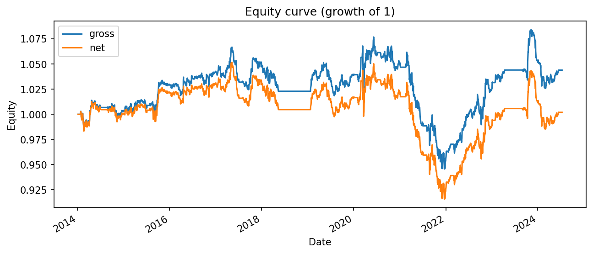
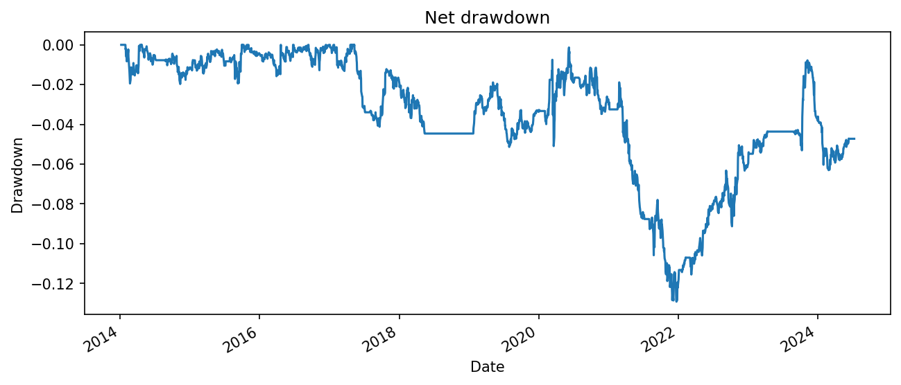
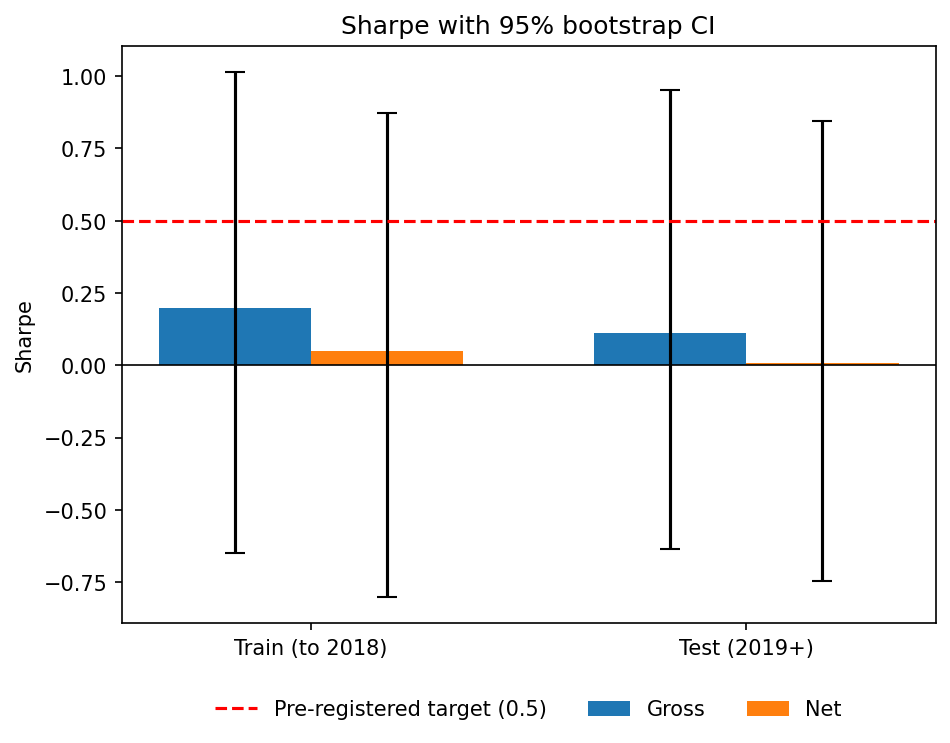
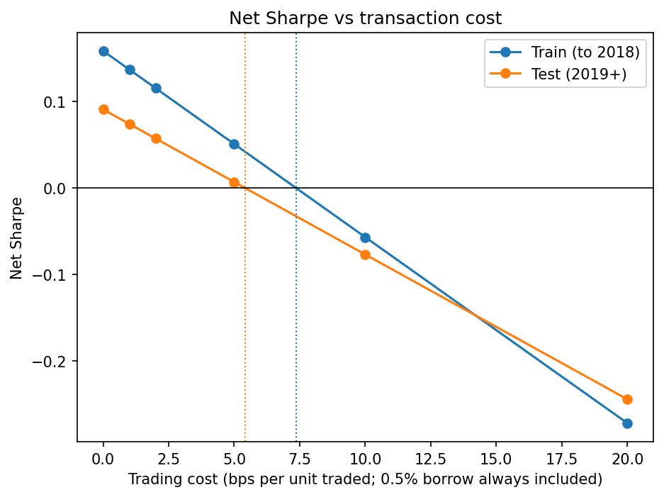

# Walk-Forward Pairs Trading Backtester

A backtester for cointegration-based pairs trading on US consumer staples stocks, built to answer one question honestly: **does a standard pairs strategy survive realistic costs and out-of-sample testing?**

**Short answer: no.** Net of costs, the strategy earned a Sharpe ratio of about 0.05 in the training period and 0.01 in the test period, failing the success criterion (0.5) that I fixed in [`PROTOCOL.md`](PROTOCOL.md) before looking at any results. The more interesting finding is *why*, covered below.

---

## Results

Setup: up to 14 US consumer staples stocks, daily adjusted closes 2012-2024, 504-day formation window, 126-day trading window, 21 walk-forward windows (first trades January 2014). Base-case costs: 5 bps per unit traded plus 0.5% annual borrow on the short leg.

| | Gross Sharpe | Net Sharpe | Net ann. return | Net max drawdown |
|---|---|---|---|---|
| Train (trades before 2019) | 0.20 | 0.05 | 0.13% | -4.5% |
| Test (2019 onwards) | 0.11 | 0.01 | 0.03% | -12.8% |

- **No detectable edge, even before costs.** The 95% block-bootstrap CI for the test-period Sharpe is [-0.64, +0.95] gross and [-0.74, +0.84] net. Both contain zero. They also contain 0.5, so six years of daily data cannot rule out a modest edge either. The honest statement is *no evidence of an edge, and low power to detect a small one*.
- **Costs erase the small point estimate.** Under the cost model, net Sharpe reaches zero at about **7.4 bps (train)** and **5.4 bps (test)** per unit traded. Costs are not the main story, since there is no significant edge to erase, but they take any positive point estimate to zero at realistic cost levels.
- **The selected pairs mostly did not stay cointegrated.** Of 85 pairs selected across all windows (each passed an Engle-Granger test at 5% in its formation window), only **8.2%** still passed at 5% in the following six months (15.3% at 10%). A true non-relationship passes a 5% test about 5% of the time, so this is close to the false-positive rate. Consistent with that, the number of pairs passing the formation test averaged 6.7 per window against about 4.5 expected from luck alone (91 pairs x 5%), and in the 2014-2018 windows it was right at chance.

| Equity curve | Net drawdown |
|---|---|
|  |  |
| **Sharpe with 95% bootstrap CI** | **Net Sharpe vs cost** |
|  |  |

Single-pair diagnostics (z-score and positions for one pair that reverted, and one whose relationship broke down after formation) are in `results/one_pair0.png` and `results/one_pair1.png`.

---

## Method

**Strategy.** In each formation window, test every pair of stocks for cointegration (Engle-Granger on log prices, p < 0.05). For each passing pair, estimate the hedge ratio β by OLS, form the spread `log(A) - β·log(B)`, and keep pairs with a positive β and a mean-reversion half-life between 2 and 60 days. Take the 5 best (lowest p-value). Over the following 126 trading days, compute the z-score of each spread **using the formation window's mean and standard deviation**, enter when |z| > 2 (short the spread if z is high, long if low), exit when |z| < 0.5, and stop out when |z| > 4. Capital is split equally across 5 slots.

**Walk-forward.** Pair selection, β, and z-score statistics are re-estimated every 126 days using only past data, so every trade is out-of-sample by construction.

**Train / test split.** Fixed in advance in `PROTOCOL.md`: trades before 2019-01-01 are the training period, trades from 2019-01-01 are the test period. No parameters were tuned.

**Timing convention.** A signal computed from the close of day *t* sets the position held during day *t+1*, implemented as `pos.shift(1)` in `pair_pnl`.

**Costs.** 5 bps of deployed capital per unit of position change (including the forced close at the end of each window), plus a 0.5% annual borrow fee charged on an assumed half of gross exposure.

**Uncertainty.** Sharpe confidence intervals come from a block bootstrap (block length 10, 2,000 resamples, fixed seed).

---

## How lookahead bias is guarded against

Tests live in `tests/test_engine.py`. Run with `python -m pytest -v`.

| Test | What it catches |
|---|---|
| Signal truncation | Signals for days up to T are identical whether or not later data exists. |
| Walk-forward truncation | Dropping the final 300 days leaves earlier results unchanged. Catches leaks that reach beyond the end of a window. |
| Random-walk sanity check | On independent random walks (nothing to predict) the strategy must earn about zero before costs. Catches leaks that create profit from nothing. |
| Same-day PnL check | A position cannot earn the return of the day it was decided. |

**Breaking it on purpose.** To check the tests actually work, `break_it.py` injects the classic pairs-trading leak (taking the z-score mean and std from the trading window instead of the formation window) without editing the engine. Results on random-walk data with zero costs:

| Engine | Mean gross Sharpe (5 seeds) |
|---|---|
| Honest | **FILL IN** (about 0) |
| With the leak | **FILL IN** (well above 1) |

The random-walk test catches this leak. The truncation tests do not, because the leak only reaches into the same trading window, which both truncated and full runs contain. I took from this that each test catches a different class of bug, which is why the suite has several.

I also tried replacing `shift(1)` with `shift(0)`. For a mean-reversion strategy this does *not* inflate returns (the signal is contrarian to the same-day move, so the bug tends to hurt), and the random-walk test cannot see it. The same-day PnL check is the one that catches it.

---

## Limitations

- **Survivorship bias.** The universe is today's surviving large-cap staples, so history looks kinder than it was. Failed or delisted companies are absent.
- **Prices.** Adjusted closes from Yahoo Finance, with no bid-ask quotes, so spread costs are an assumption rather than a measurement.
- **Execution.** A signal computed at the close of day *t* is assumed to be filled at that same close (return accrues from close *t* to close *t+1*). This needs market-on-close orders and is slightly optimistic.
- **Costs are simplified.** One flat charge per unit traded, and borrow assumes half of gross exposure is short at a flat rate. Hard-to-borrow names would cost more.
- **Idle capital.** Capital is always divided by 5, so windows with fewer than 5 pairs hold cash. This lowers volatility and return.
- **Low statistical power.** Cointegration is re-tested on 126-day windows, which will miss some genuine relationships. Pairs also repeat across windows (and share stocks), so the 85 stability observations and the false-positive comparison are not independent.
- **Small universe.** 14 stocks in one sector gives few candidate pairs.
- **Test set exposure.** I printed the full-period (train + test) result once before running the split. No parameters were changed afterwards, but the test set was not seen for the first time only at the end.
- **Number of configurations.** One strategy configuration was run, fixed in advance. The cost sweep (0 to 20 bps) is a sensitivity analysis, not a parameter search. No parameter grid was run.

## Possible next steps

Time-based exits (e.g. 2x the half-life) to limit losses when a relationship breaks; a multiple-testing correction in pair selection; a larger universe and point-in-time constituents; rolling or Kalman-filter hedge ratios; a deflated Sharpe ratio; real bid-ask data.

---

## Reproduce

```bash
pip install pandas numpy statsmodels matplotlib yfinance pytest
python -m pytest -v          # run the tests
python run.py                # run the experiment (the cost sweep takes a few minutes)
python make_charts.py        # redraw the charts from results/
python break_it.py           # demonstrate the injected-leak check
```

`prices.csv` is included so results reproduce exactly. Yahoo Finance can revise adjusted prices between downloads.

```
data.py          load and cache prices
engine.py        signals, pair selection, PnL with costs, walk-forward, metrics
run.py           run the experiment, save results/
make_charts.py   draw charts from saved results
break_it.py      inject a deliberate leak and check the tests notice
PROTOCOL.md      hypothesis, universe, split dates, success criterion (written before results)
tests/           lookahead and sanity tests
results/         CSVs, summary.json and charts
```
